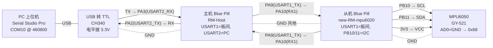

# MPU6050 双板姿态采集系统开发文档

| 项目 | 内容 |
| --- | --- |
| 课题 | STM32 基础 — MPU6050 双板姿态采集与上位机显示 |
| 硬件 | STM32F103C8T6 最小系统板 ×2、MPU6050（GY-521）、USB 转 TTL ×1 |
| 开发工具 | Keil MDK 5.32+（实测 ARM Compiler V5.06）、STM32CubeMX 6.18.1、HAL FW_F1 V1.8.7、Serial Studio Pro 4.2.0 |
| 从机工程 | `new-RM-mpu6020`（原版固件，未改动，实测串口有数据） |
| 主机工程 | `RM-Host`（最小修改：USART1 波特率 460800 + 主循环统一转发） |
| 上位机工程 | `波形图.ssproj`（COM10，460800，解析器已修正） |
| 关键接口 | 软件 I2C：SCL=PB10、SDA=PB11；板间 USART1 @460800；主机→PC USART2 @460800 |
| 当前状态 | **已联调通过**：主机串口有数据流，Serial Studio 三轴波形正常显示 |

> 版本说明：本版文档对应“回档后的从机原版固件 + 主机最小修改”这一当前可运行版本。
> 第 12 章如实列出当前固件中尚未实现或存在风险的条目，供后续迭代参考。

## 1. 任务目标与实现状态

| 编号 | 指标 | 当前状态 |
| --- | --- | --- |
| 1.1 | 从机定时器触发 I²C 读取，采样 1 kHz | TIM2 每 1 ms 置标志，主循环读取（实现，存在时序余量风险，见 12.5） |
| 1.2 | 滤波解算 Pitch、Roll、Yaw、Quaternion | Mahony 互补滤波（实现） |
| 1.3 | 上电自校准与零飘抑制 | 静止采样平均求零偏（实现） |
| 2.1 | 从机每 1 ms 发送一帧“四元数 + 欧拉角” | 27 字节帧，阻塞发送（实现） |
| 2.2 | 主机 CRC 校验，失败请求从机重传 | 主机侧实现；从机因接收中断未开而收不到重传请求（见 12.1） |
| 3.1 | 上位机实时绘制三轴角度波形 | Serial Studio Pro 三曲线（**已实现并验证**） |
| 3.2 | 上位机下发指令动态调整滤波加权系数 | 未实现（主机透传了指令，但从机未解析，见 12.2） |

## 2. 系统总体架构

```text
┌──────────────┐  USB   ┌─────────────┐ USART2(460800) ┌──────────────┐ USART1(460800) ┌──────────────┐  软件I2C  ┌──────────┐
│ PC           │◄──────►│ USB 转 TTL  │◄───────────────►│ 主机 BluePill│◄───────────────►│ 从机 BluePill│◄─────────►│ MPU6050  │
│ SerialStudio │        │ CH340 COM10 │  PA2/PA3 + GND  │ RM-Host      │  PA9/PA10 + GND │ new-RM-...   │ PB10/PB11 │ GY-521   │
└──────────────┘        └─────────────┘                 └──────────────┘                 └──────────────┘           └──────────┘
   波形显示                 电平转换                        校验/转发/请求重传               1kHz采样/滤波/组帧             原始数据
```

数据流方向：

1. 从机 TIM2 每 1 ms 触发一次采样，软件 I2C 读 MPU6050 原始数据；
2. 从机做零偏补偿与 Mahony 滤波，解算四元数与欧拉角；
3. 从机组 27 字节帧，经 USART1（PA9/PA10）发往主机；
4. 主机做帧解析与 CRC8 校验：通过则经 USART2 透传 PC，失败则发“重传请求”（从机侧暂未响应，见 12.1）；
5. PC 端 Serial Studio Pro 按帧解析并绘制 roll / pitch / yaw 三轴波形。

## 3. 接线图

### 3.1 接线图（Mermaid，可在支持 Mermaid 的 Markdown 阅读器中渲染）



> 打印级高清版本见同目录下的 [接线图.svg](./接线图.svg)。

### 3.2 接线表

| 起点 | 终点 | 线色建议 | 说明 |
| --- | --- | --- | --- |
| 从机 PB10 | MPU6050 SCL | 绿 | 软件 I2C 时钟 |
| 从机 PB11 | MPU6050 SDA | 绿 | 软件 I2C 数据 |
| 从机 3V3 | MPU6050 VCC | 红 | 模块供电 |
| 从机 GND | MPU6050 GND | 黑 | 共地 |
| MPU6050 AD0 | MPU6050 GND | 短接 | 器件地址 0x68（接 3V3 则为 0x69，与代码不符） |
| 从机 PA9 (USART1_TX) | 主机 PA10 (USART1_RX) | 蓝 | 板间 UART 460800，TX↔RX 交叉 |
| 从机 PA10 (USART1_RX) | 主机 PA9 (USART1_TX) | 蓝 | 板间 UART 460800 |
| 从机 GND | 主机 GND | 黑 | 板间必须共地 |
| 主机 PA2 (USART2_TX) | USB-TTL RX | 橙 | 主机 → PC |
| 主机 PA3 (USART2_RX) | USB-TTL TX | 橙 | PC → 主机 |
| 主机 GND | USB-TTL GND | 黑 | 共地 |
| USB-TTL USB 口 | PC USB 口 | — | 标准 USB 线 |

### 3.3 供电与安全事项

- 两块 Blue Pill 各自由 ST-Link 或 Micro-USB 供电；MPU6050 由从机 3.3V 供电。
- 全系统共用同一条 GND 网络（从机、主机、USB-TTL、MPU6050 四处共地）。
- USB-TTL 电平拨到 3.3V，不要把 5V 接到任何 IO 引脚。
- 烧录后确认两块板 BOOT0 跳线都在 0（否则上电进入引导程序，不跑固件）。

## 4. 工程结构

### 4.1 从机 `new-RM-mpu6020`（当前为原版固件，未改动）

```text
new-RM-mpu6020/
├── new-RM-mpu6020.ioc          # CubeMX：TIM2 1ms、USART1 460800、PB10/PB11 开漏
├── Core/Src/
│   ├── main.c                  # 主循环：TIM2 标志 → 读 MPU → Mahony → 组帧发送
│   ├── tim.c                   # TIM2：PSC=71, ARR=999 → 1 kHz
│   ├── usart.c                 # USART1 @460800（PA9/PA10）
│   ├── gpio.c                  # PB10/PB11 开漏输出 + 上拉
│   └── stm32f1xx_it.c          # 中断服务函数（当前无 USART1 中断，见 12.1）
└── MDK-ARM/
    ├── soft_i2c.c / .h         # 软件 I2C：HAL 引脚操作 + 忙等延时（约 5μs/拍）
    ├── mpu6050.c / .h          # MPU6050 初始化、读取、自校准
    ├── mahony.c / .h           # Mahony 滤波（Kp=2.0, Ki=0.005）+ 欧拉角解算
    └── slave_comm.c / .h       # CRC8、27 字节组帧发送
```

### 4.2 主机 `RM-Host`（最小修改版）

```text
RM-Host/
├── RM-Host.ioc                 # CubeMX：USART1 460800、USART2 460800、PA13/PA14 SWD
├── Core/Src/
│   ├── main.c                  # 初始化 + 中断回调 + 主循环 Master_Poll()
│   ├── usart.c                 # USART1 @460800、USART2 @460800
│   ├── gpio.c                  # 仅时钟使能（无 LED 引脚）
│   └── tim.c                   # TIM2（保留未用，可删）
└── MDK-ARM/
    ├── master_comm.c / .h      # 帧状态机、CRC8、重传请求、PC 指令透传、Master_Poll()
    └── RM-Host.uvprojx         # Keil 工程
```

## 5. 从机固件设计

### 5.1 时钟树

- HSE 8 MHz → PLL ×9 → SYSCLK = 72 MHz，APB1 = 36 MHz，APB2 = 72 MHz；
- TIM2 挂在 APB1 定时器倍频上，计数时钟 = 72 MHz；
- `Prescaler = 71`（1 MHz 计数）、`Period = 999`（1000 计数）→ 中断周期恰为 1 ms。

### 5.2 软件 I2C（PB10/PB11）

- CubeMX 中 PB10/PB11 配置为 `GPIO_MODE_OUTPUT_OD`（开漏）+ 内部上拉；
- 引脚操作通过 `HAL_GPIO_WritePin / ReadPin` 完成；
- 时序用空循环忙等（`i=50` 次，约 5 μs/拍），约 100 kHz 量级；
- 提供 `I2C_Start/Stop`、按字节收发、`I2C_WaitAck`（带超时）、`I2C_ReadRegs`
  （先写寄存器地址，重复起始后连续读 14 字节，末字节 NACK）。

### 5.3 MPU6050 初始化寄存器配置

| 寄存器 | 值 | 含义 |
| --- | --- | --- |
| WHO_AM_I (0x75) | 应读回 0x68 | 器件存在性检查 |
| PWR_MGMT_1 (0x6B) | 0x80 → 100 ms → 0x01 | 复位 → 唤醒，X 轴陀螺仪为时钟源 |
| SMPLRT_DIV (0x19) | 0x00 | 采样率 = 1 kHz / (1+0) = 1 kHz |
| CONFIG (0x1A) | 0x03 | DLPF：44 Hz 带宽、4.9 ms 群延迟 |
| GYRO_CONFIG (0x1B) | 0x00 | ±250 °/s，灵敏度 131 LSB/(°/s) |
| ACCEL_CONFIG (0x1C) | 0x00 | ±2 g，灵敏度 16384 LSB/g |

### 5.4 数据读取

`MPU6050_ReadData()` 从 `ACCEL_XOUT_H (0x3B)` 起连续读 14 字节（加速度 6 + 温度 2 +
角速度 6），按灵敏度换算为物理量并减去零偏：

```c
ax_f = ax / 16384.0f - accel_offset_x;   // g
gx_f = gx / 131.0f  - gyro_offset_x;     // °/s
```

### 5.5 上电自校准与零飘抑制

`MPU6050_Calibrate(200)`：上电时要求模块**水平静止放置**，连续采样 200 次（间隔
5 ms，约 1 s）取平均：

- 陀螺仪零偏 = 静止角速度平均值（后续每拍减去，抑制零飘）；
- 加速度计零偏 = 平均值，且 Z 轴减去 1 g（水平静止时 az ≈ 1 g）。

### 5.6 主循环与 1 kHz 触发流程

```text
TIM2 中断(1ms)                主循环 while(1)
    │                             │
    └─ mpu_update_flag = 1 ──────► 清标志
                                  ├─ MPU6050_ReadData()（软件 I2C 读 14 字节）
                                  ├─ Mahony_Update(..., dt=0.001f)（固定步长）
                                  ├─ Mahony_GetEulerAngle()
                                  └─ Slave_SendFrame()（阻塞发送 27 字节）
```

- 采样节拍由 TIM2 严格保证；但每拍处理总时间必须小于 1 ms，否则标志合并、实际
  采样率下降（预算分析见 12.5）；
- dt 固定取 0.001 s，未按真实周期修正（见 12.5）。

### 5.7 Mahony 互补滤波

参数（`mahony.h`）：`Kp = 2.0f`（加速度计修正强度）、`Ki = 0.005f`（零偏修正项）。

算法流程（`mahony.c`）：

1. 角速度 °/s → rad/s；加速度归一化；
2. 由当前四元数估计重力方向，与实测加速度叉积得误差 `halfe`；
3. `Ki * halfe * dt * 2` 与 `Kp * halfe * 2` 直接反馈到角速度（Ki 项未做积分累积，
   见 12.6）；
4. 一阶积分四元数微分方程并归一化；
5. `Mahony_GetEulerAngle()` 用标准公式解算 roll / pitch / yaw（度）。

## 6. 板间通信协议

### 6.1 姿态数据帧（从机 → 主机，1 kHz）

总长 **27 字节**，小端序：

| 偏移 | 长度 | 字段 | 说明 |
| --- | --- | --- | --- |
| 0 | 1 | 0xAA | 帧头 1 |
| 1 | 1 | 0x55 | 帧头 2 |
| 2 | 1 | 0x01 | 帧类型：姿态数据 |
| 3 | 4 | q0 (float32) | 四元数 |
| 7 | 4 | q1 (float32) | 四元数 |
| 11 | 4 | q2 (float32) | 四元数 |
| 15 | 4 | q3 (float32) | 四元数 |
| 19 | 2 | roll (int16) | 角度 ×100，保留两位小数 |
| 21 | 2 | pitch (int16) | 角度 ×100 |
| 23 | 2 | yaw (int16) | 角度 ×100 |
| 25 | 1 | CRC8 | 覆盖偏移 2~24 共 23 字节 |
| 26 | 1 | 0x0D | 帧尾 |

CRC8：多项式 `0x07`，初值 `0x00`，逐位右移异或（从机 `slave_comm.c` 与主机
`master_comm.c` 实现一致）。

### 6.2 重传请求（主机 → 从机，共 5 字节）

| 偏移 | 值 | 说明 |
| --- | --- | --- |
| 0 | 0xAA | 帧头 1 |
| 1 | 0x55 | 帧头 2 |
| 2 | 0x02 | 帧类型：重传请求 |
| 3 | CRC8 | 对偏移 2 的 1 字节求 CRC |
| 4 | 0x0D | 帧尾 |

主机在校验失败时发出。从机当前未开 USART1 接收中断，暂时收不到该请求（见 12.1）。

### 6.3 调参指令（PC → 主机 → 从机，共 12 字节，预留）

| 偏移 | 值/字段 | 说明 |
| --- | --- | --- |
| 0 | 0xAA | 帧头 1 |
| 1 | 0x55 | 帧头 2 |
| 2 | 0x03 | 帧类型：滤波参数 |
| 3 | Kp (float32) | Mahony 比例增益 |
| 7 | Ki (float32) | Mahony 积分增益 |
| 11 | 0x0D | 帧尾 |

当前主机 `PC_ProcessCommand` 只校验帧尾后原样透传，从机未解析该帧，功能未打通
（见 12.2）。示例帧见 13.2。

### 6.4 波特率与带宽核算

| 链路 | 参数 | 说明 |
| --- | --- | --- |
| 从机 USART1（板间） | 460800 / 8N1 | 27 字节 ≈ 0.586 ms/帧，1 ms 周期内可发完 |
| 主机 USART1（板间） | 460800 / 8N1 | 与从机一致（此前曾误配为 115200，已修复） |
| 主机 USART2（PC） | 460800 / 8N1 | 与 `波形图.ssproj` 串口设置一致 |

## 7. 主机固件设计

### 7.1 接收状态机

`master_comm.c` 对 USART1 字节流做状态机解析：

```text
HEADER1(0xAA) → HEADER2(0x55) → TYPE(1B) → DATA(22B) → CRC(1B) → TAIL(0x0D)
     ▲              │(再次收到AA则重等55)                                    │
     └──────────────┴────────────────────────────────────────────────────┘
                           任意状态失败 → 回到 HEADER1
```

- DATA 段 = 四元数 16 字节 + 欧拉角 6 字节 = 22 字节；
- 帧尾命中后对 `buffer[2..24]`（23 字节）算 CRC8，与 `buffer[25]` 比较；
- 通过 → 拷贝到发送缓冲并置标志；失败 → 置重传标志。

### 7.2 主循环统一发送（本版关键修改）

中断回调内**只解析、置标志**，不做阻塞发送。`Master_Poll()` 在主循环里统一执行：

- 有效帧 → `HAL_UART_Transmit(&huart2, tx_to_pc, 27, 10)` 转发给 PC；
- 校验失败 → `Master_RequestRetransmit()` 发 5 字节重传请求。

这样避免了原先“在中断里阻塞发送 27 字节（约 0.59 ms）导致下一帧字节丢失”的问题。

### 7.3 PC 指令透传

`PC_ProcessCommand()` 从 USART2 按 12 字节收集，只校验帧尾 `0x0D`，通过后在中断
里直接 `HAL_UART_Transmit(&huart1, pc_buf, 12, 10)` 透传给从机（指令偶尔下发，
阻塞影响可忽略）。

## 8. 上位机（Serial Studio Pro）

### 8.1 打开工程

1. 先关闭其他占用串口的助手（一个 COM 口只能被一个软件打开）；
2. 用 Serial Studio Pro 打开 `波形图.ssproj`；
3. “设备 A”的连接设置已保存：CH340、COM10、460800、8N1（若重新插拔后端口变化，
   改成设备管理器里的新 COM 号）；
4. 点设备管理器里的连接按钮，连接成功后“姿态角”面板即开始绘制三条曲线。

### 8.2 帧解析器

Serial Studio 会先剥离帧头 `AA 55` 与帧尾 `0D`，再把中间 24 字节交给 JS
`parse()`：

```text
[0]=type  [1..4]=q0  [5..8]=q1  [9..12]=q2  [13..16]=q3
[17..18]=roll×100  [19..20]=pitch×100  [21..22]=yaw×100  [23]=CRC8
```

工程内的解析器（已修正偏移并验证）：

```javascript
function parse(frame) {
    function f32(a) { return new Float32Array(new Uint8Array(a).buffer)[0]; }
    function i16(a) { return new Int16Array(new Uint8Array(a).buffer)[0]; }
    const q0 = f32(frame.slice(1, 5));
    const q1 = f32(frame.slice(5, 9));
    const q2 = f32(frame.slice(9, 13));
    const q3 = f32(frame.slice(13, 17));
    const roll  = i16(frame.slice(17, 19)) / 100.0;
    const pitch = i16(frame.slice(19, 21)) / 100.0;
    const yaw   = i16(frame.slice(21, 23)) / 100.0;
    return [roll, pitch, yaw, q0, q1, q2, q3];
}
```

返回数组的第 1、2、3 项依次对应 roll / pitch / yaw 三条曲线。

### 8.3 波形显示

- “姿态角”组使用多曲线组件（multiplot），量程 ±180°，数值显示两位小数；
- 水平静置时 roll/pitch ≈ 0，yaw 缓慢漂移属正常现象；
- 偶发错帧：单字节帧尾 0x0D 与二进制负载存在小概率冲突（约 9%/帧，见 12.8）。

## 9. 编译与烧录

1. Keil MDK 打开 `RM-Host/MDK-ARM/RM-Host.uvprojx`；
2. 主机工程当前 0 Error / 0 Warning（已用 ARM Compiler V5.06 验证），固件位于
   `RM-Host/MDK-ARM/RM-Host/RM-Host.hex`；
3. 从机固件保持原版未改动，使用此前验证过能输出数据的 hex；
4. 主机用 ST-Link + SWD 烧录（PA13/PA14 为 Serial Wire，`gpio.c` 未占用调试脚）；
5. 上电顺序：从机水平静置 → 上电完成约 1 s 自校准 → 打开上位机连接 COM10。

## 10. 联调与验收清单

| 步骤 | 检查项 | 状态 |
| --- | --- | --- |
| 1 | 从机串口（PA9，460800）能直接看到 `AA 55 01 ...` 数据流 | 已验证通过 |
| 2 | 主机串口（PA2，460800）能看到从机转发来的数据流 | 已验证通过 |
| 3 | Serial Studio 连接 COM10 后 roll/pitch/yaw 三条曲线滚动 | 已验证通过 |
| 4 | 水平静置 roll/pitch ≈ 0，晃动模块曲线快速跟随、静置回落 | 待最终确认 |
| 5 | CRC 失败时主机发 0x02 重传请求、从机响应重发 | 未实现（见 12.1） |
| 6 | 下发 0x03 指令调整 Kp/Ki 生效 | 未实现（见 12.2） |

## 11. 常见故障排查

| 现象 | 排查顺序 |
| --- | --- |
| PC 完全无数据 | ① 串口助手与 Serial Studio 不能同时占用同一 COM ② 主机 PA2/PA3 与 TTL 的接线方向（TTL RX←PA2，TTL TX→PA3） ③ TTL 电平拨 3.3V ④ BOOT0=0 |
| 主机有数据但波形空白 | 检查 Serial Studio 是否点了连接、端口/波特率是否 460800；在“控制台”视图确认原始字节是否滚动 |
| 波形乱跳或偶发错帧 | 单字节帧尾与负载 0x0D 冲突（12.8）；检查板间共地、杜邦线接触 |
| 从机无输出 | 检查 MPU6050：SCL/PB10、SDA/PB11 是否接反、AD0 是否接 GND、模块 3V3 供电 |

## 12. 已知问题与待完善项（当前固件如实状态）

| 编号 | 说明 | 建议 |
| --- | --- | --- |
| 12.1 | 从机 USART1 接收中断未使能（`.ioc` 无 NVIC 配置、无中断服务函数），主机发来的重传请求与调参指令从机收不到 | 在 CubeMX 中为从机 USART1 勾选 Global interrupt 重新生成，并补充回调处理 |
| 12.2 | “上位机动态调整 Kp/Ki”未实现：从机没有解析 0x03 帧的代码（`Slave_ProcessCommand` 仅声明未定义） | 在从机侧补命令解析，把 Kp/Ki 写入 `mahony_params` |
| 12.3 | 从机“重传”路径在中断回调里阻塞调用 `Slave_SendFrame()`，且发送的是最新数据而非上一帧 | 收到重传请求后改为重发上一帧副本，发送移到主循环 |
| 12.4 | 从机 MPU6050 初始化失败的死循环被注释，失败后仍会发送无效数据 | 恢复错误处理（LED 报警/停止发送） |
| 12.5 | 1 kHz 时序紧张：软件 I2C（HAL + 忙等）加 27 字节阻塞发送，单拍可能超过 1 ms；dt 固定 0.001 s | 软件 I2C 改用寄存器操作/DWT 延时、发送改 DMA、dt 按真实周期计算 |
| 12.6 | Mahony 的 Ki 项直接加到角速度，没有积分状态累积，零偏自收敛能力弱 | 按标准 Mahony 累加 `integralFB` 并限幅 |
| 12.7 | DLPF=0x03（44 Hz 带宽、4.9 ms 延迟）与 1 kHz 采样目标不匹配 | CONFIG 改 0x00（256 Hz） |
| 12.8 | 单字节帧尾 0x0D 与二进制负载冲突（约 9%/帧可能被上位机提前截断） | 改 ASCII 输出或双字节帧尾；或接受偶发错帧 |
| 12.9 | 主机 `PC_ProcessCommand` 只查帧尾 0x0D；状态机 STATE_TYPE 未校验 0x01 | 按协议严格校验帧头/帧型/CRC |
| 12.10 | 主机 TIM2 已初始化但未使用；主机无 LED 指示 | 可删除 TIM2，或补 PC13 LED 作为链路指示 |

## 13. 附录

### 13.1 寄存器速查

| 名称 | 地址 | 本项目用途 |
| --- | --- | --- |
| ACCEL_XOUT_H | 0x3B | 连续读 14 字节的起始地址 |
| SMPLRT_DIV | 0x19 | 1 kHz 采样 |
| CONFIG | 0x1A | DLPF 带宽（当前 0x03） |
| GYRO_CONFIG | 0x1B | ±250 °/s |
| ACCEL_CONFIG | 0x1C | ±2 g |
| PWR_MGMT_1 | 0x6B | 复位/唤醒 |
| WHO_AM_I | 0x75 | 器件检查（0x68） |

### 13.2 调参指令示例（预留格式，当前固件不生效）

把 Kp 设为 2.0、Ki 设为 0.005 的完整 12 字节十六进制指令（小端 float，无 CRC）：

```text
AA 55 03 00 00 00 40 0A D7 A3 3B 0D
```

其中 `00 00 00 40` = 2.0f，`0A D7 A3 3B` = 0.005f。该格式待从机实现 12.2 后生效。

### 13.3 参考

- MPU-6000/6050 Register Map and Descriptions（InvenSense）；
- Mahony, R., Hamel, T., Pflimlin, J.-M. “Nonlinear Complementary Filters on the
  Special Orthogonal Group”；
- Serial Studio 项目格式与 Frame Parser 说明（serial-studio.github.io）。
